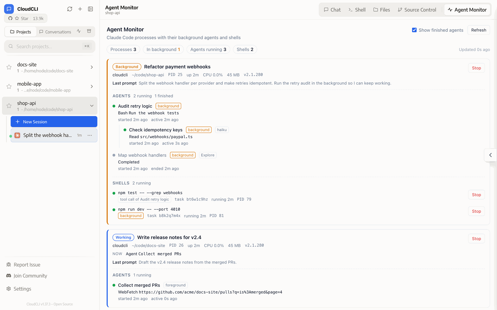
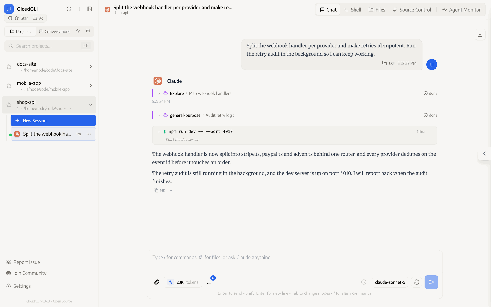
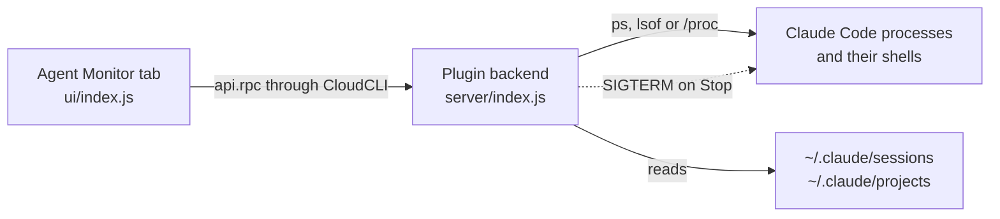

<div align="center">
  <h1>Agent Monitor</h1>
  <p>See what your Claude Code sessions are still doing after the chat says they are done.<br>
  A tab plugin for <a href="https://github.com/siteboon/claudecodeui">CloudCLI UI</a>.</p>
  <p>
    <a href="https://github.com/notetook/cloudcli-plugin-agent-monitor/actions/workflows/test.yml"></a>
    <a href="LICENSE"></a>
    <a href="#requirements"></a>
  </p>
</div>

<picture>
  <source media="(prefers-color-scheme: dark)" srcset="docs/monitor-dark.png">
  
</picture>

## Why

CloudCLI marks a chat as finished as soon as Claude's turn ends. If that turn started background work, such as a subagent running in the background, a background Bash command or a Monitor tool call, the Claude process keeps going: CloudCLI 1.37.2 and later hold it open until the work reports back, or until it has been silent for 30 minutes. Nothing in the chat shows that this is happening. Here the chat lists both agents as done and Claude has said its last word:

<picture>
  <source media="(prefers-color-scheme: dark)" srcset="docs/chat-dark.png">
  
</picture>

At that very moment, the screenshot at the top shows the retry audit, a check it started, its test run and the dev server all still running.

A process list can tell you that a Claude process is still alive. Agent Monitor also looks inside it: which subagents are still working, what tool each one is calling, which shell commands are running, and whether the turn has actually ended. You can stop a process or a single shell from the same tab.

The screenshots show a staged demo in a real CloudCLI 1.37.3; [dev/demo](dev/demo) has everything to run it yourself.

## Features

- **Every running Claude Code process**, whether CloudCLI started it or it runs in a terminal or an IDE, with its session title, project, PID, uptime, CPU and memory.
- **A clear status** for each one: *Working* while a turn is in progress, *Background* when the turn has ended but agents, workflows or shells are still running, *Idle* when nothing is running.
- **Subagents**, nested under the agent that started them, with their current tool call, start time and last activity. Finished agents are one checkbox away.
- **Workflows** started with the Workflow tool, with how many of their agents have finished and the agents still running, each with its label, phase and current tool call.
- **Shells** that Bash tool calls are running, marked as background work or as the tool call a thread is waiting on.
- **Stop buttons** for a process or a single shell, with a second click to confirm.
- Refreshes every 4 seconds while the tab is visible. Follows CloudCLI's light or dark theme, using the host's colour variables, fonts and corner radius, and its language setting (English and Korean so far; other languages show English).
- No dependencies, no build step, and nothing leaves your machine.

## Install

In CloudCLI, open **Settings > Plugins**, paste this URL and click **Install**:

```
https://github.com/notetook/cloudcli-plugin-agent-monitor
```

The **Agents** tab appears once the install finishes. Use **Pull latest from git** on the same page to update it, and **Uninstall plugin** to remove it.

To install by hand instead, clone the repository into CloudCLI's plugin folder and reload CloudCLI in the browser:

```bash
git clone https://github.com/notetook/cloudcli-plugin-agent-monitor.git ~/.claude-code-ui/plugins/cloudcli-plugin-agent-monitor
```

## Requirements

- **CloudCLI UI 1.25 or newer**, the first release with plugin backends. The plugin is most useful from 1.37.2, which keeps Claude processes open while their background work runs.
- **Claude Code** with subagent transcripts under `<session>/subagents/`. The transcript format is not documented; Agent Monitor was checked against 2.1.280.
- **Node.js 22 or newer**, which CloudCLI already requires.
- **macOS or Linux** with `ps`. Minimal Linux images may need the `procps` package. Windows is not supported.

Tested with CloudCLI UI 1.37.3 and Claude Code 2.1.280 on macOS 26.3 (Node.js 22.22), and in Debian 12 containers on arm64 with Node.js 22 and 24, including CloudCLI 1.37.3 running there.

## Reading the tab

| You see | It means |
| --- | --- |
| **Working** | A turn is in progress: Claude is generating, or waiting on a tool call. |
| **Background** | The turn has ended, but subagents, workflows or shells are still running. This is the case CloudCLI does not show. |
| **Idle** | The process is alive but nothing Agent Monitor can see runs in it. A terminal session waiting for input looks like this, and so does a CloudCLI process kept open for a scheduled wake-up. |
| *quiet for 12m* | A running agent has written nothing for that long (shown after 5 minutes). It may be waiting on a long command, or it may be stuck. |
| *current tool call* | A shell whose command a thread is waiting on. *tool call of X* means agent X is waiting on it. |
| *background* (shell) | A shell started in the background, such as a dev server or a long test run. |

Agents end as *Completed*, *Failed* (an API error), *Interrupted* or *Stopped*. Turn on **Show finished agents** to list the ones that ended while the current process was running (up to 20 per process), along with finished workflows and the finished agents of running ones.

When CloudCLI runs a new turn while an older process is still finishing background work, both processes are listed, each with its own agents and shells.

## Stopping things

**Stop** on a process sends `SIGTERM` to that Claude process, then `SIGKILL` if it is still running 5 seconds later, and then stops any tool shells it left behind. Its background agents end with it. If CloudCLI started the process, CloudCLI may show an error in that chat, because from its side the Claude process died.

**Stop** on a shell signals the shell's whole process group, so the command and everything it started end together. Claude sees the command fail.

Both ask for a second click. Before sending any signal, the backend checks the target against a fresh process list: only Claude Code processes and the Bash shells they own can be stopped.

## How it works



| What | Where it comes from |
| --- | --- |
| Claude Code processes and their shells | `ps`, plus `lsof` on macOS or `/proc` on Linux |
| Session id, project and entry point | `~/.claude/sessions/<pid>.json`, which Claude Code writes for each running process |
| Session title, last prompt and turn state | the session transcript, `~/.claude/projects/<project>/<session>.jsonl` |
| Subagents | `<session>/subagents/agent-<id>.jsonl` and `agent-<id>.meta.json` |
| Workflows and their agents | `<session>/subagents/workflows/<run>/`, with an `agent-<id>.jsonl` per agent and the run's `journal.jsonl`; the name from `<session>/workflows/<run>.json` or the script in `<session>/workflows/scripts/` |
| Background agents that have finished | the task notifications Claude Code records in the transcripts |

- An agent counts as finished when its transcript ends with a final answer, an API error or an interruption, or when Claude Code has queued a task notification for it and the agent has written nothing since. Only entries that Claude Code writes for notifications count, so notification text quoted inside a conversation is never mistaken for one.
- A workflow agent counts as finished when the run's journal records its result or failure, or when its transcript ends. A workflow is running while any of its agents is, and between phases until its task notification arrives or it has been quiet for a minute.
- CloudCLI runs each turn in a new Claude process. An agent belongs to the newest process that was already running when the agent started, and nested agents follow their root agent.
- A shell counts as a tool call when its command matches a Bash call that the main thread or an agent is still waiting on. Any other shell is background work.
- Transcripts are read incrementally. The first look at a large transcript reads it once; later refreshes read only what was appended. On macOS with a 25 MB transcript, the first refresh took about 120 ms and later ones about 40 ms.

## Privacy and security

- The backend reads `~/.claude` and process information. It never writes to them, makes no network requests and collects no telemetry.
- The tab shows session titles, last prompts, agent descriptions and running commands. Keep that in mind when you share your screen.
- The backend listens on `127.0.0.1` only. Like every CloudCLI plugin backend, it has no authentication of its own, so other programs on the same machine can reach it.
- Stop requests are checked against a fresh process list, and only Claude Code processes and their Bash shells can be signalled.

To report a vulnerability, see [SECURITY.md](SECURITY.md).

## Troubleshooting

**The tab does not appear.** Reload CloudCLI in the browser, then check that Agent Monitor (listed as **Agents**) is enabled in **Settings > Plugins**.

**"Could not load status".** The text after the colon comes from the backend. If the backend does not start at all, CloudCLI's server log has the reason in lines starting with `[Plugins]` or `[Plugin:agent-monitor]`.

**A Claude session is running but not listed, or listed without its title.** Agent Monitor sees processes on the machine that runs CloudCLI and reads session details from your own `~/.claude`. Sessions in containers or on other hosts are not visible, and sessions of other users appear without their details. If you set `CLAUDE_CONFIG_DIR`, note that CloudCLI does not pass it to plugins, so the plugin reads `~/.claude`.

**An agent shows the wrong state.** Claude Code's transcript format can change between versions. Please [open an issue](https://github.com/notetook/cloudcli-plugin-agent-monitor/issues/new?template=bug_report.yml) with your Claude Code version and, if you can, the last few lines of that agent's transcript with anything private removed.

## Limitations

- Claude Code only. Codex, Gemini and Cursor sessions in CloudCLI are not shown.
- States are read from transcripts and can lag a refresh behind. An agent that stops without leaving a trace, for example because its process was killed, disappears once its process is gone; while the process lives, a long silence shows as *quiet* rather than as finished.
- Finished agents are listed only for processes that are still running.

## Development

```bash
npm test               # unit and integration tests (node:test)
npm run preview        # the tab with live data at http://127.0.0.1:4173/ (Stop really stops)
npm run preview:mock   # the tab with sample data
```

Add `?theme=dark` or `?lang=ko` to the preview URL to check the other theme or language.

To see the plugin in a real CloudCLI on Linux without touching your own, run the Docker demo described in [dev/demo](dev/demo/README.md):

```bash
docker build -t agent-monitor-demo dev/demo
docker run --rm --init -p 127.0.0.1:3101:3001 -v "$PWD":/plugin-src:ro agent-monitor-demo
```

```
server/
  index.js        HTTP server that CloudCLI starts and proxies RPC calls to
  collect.js      builds the status snapshot
  processes.js    finds Claude Code processes and their tool shells
  transcripts.js  reads session and subagent transcripts
  kill.js         stops a process or a shell, escalating to SIGKILL
ui/index.js       the tab (a single module, as CloudCLI loads it from a blob URL)
dev/              preview server, sample data and the Docker demo
test/             tests for all of the above
```

## Contributing

Bug reports, ideas and pull requests are welcome. See [CONTRIBUTING.md](CONTRIBUTING.md) for how to set up, test and preview your changes.

## License

[MIT](LICENSE)

Agent Monitor is a community plugin. It is not affiliated with Anthropic or with the CloudCLI project.
